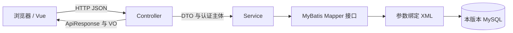
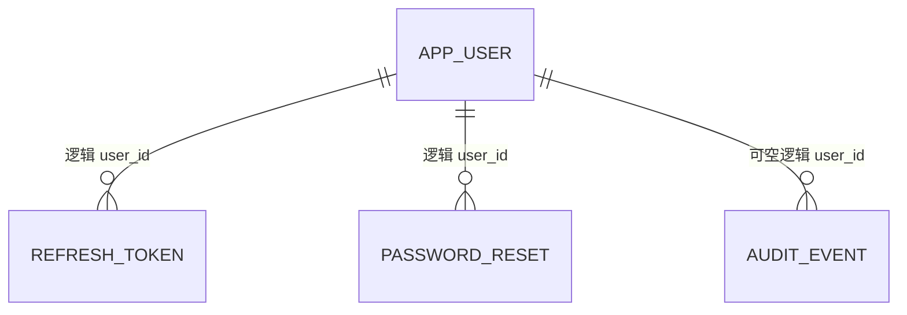

# 架构、原理与演进决策

每个版本是完整应用快照，源码和配置只在自身目录解析。backend 是独立 Maven 工程，frontend 是独立 npm 工程。系列脚本只遍历运行命令，不提供公共源码或运行时依赖。

## 分层职责

Controller 做 HTTP 参数绑定、校验和响应，Service 实现业务决策及事务，Mapper 做数据访问。V01 的 EmployeeService 接口与实现对应最初教学结构；账户版本使用单一 AccountService，不为简单服务人为增加无收益接口。MailGateway 是适配器接口，因为开发文件投递和生产 SMTP 确实有不同实现。

V01 直接返回员工实体，V02 起使用 DTO/VO 与统一响应；账户实体中的 passwordHash、authVersion 不对外暴露。Jackson 拒绝未知输入字段，个人资料 API 不接受目标用户 ID。列表上限为 200，本系列没有实现大规模分页和搜索。

## 十版的实际变化

| 版本 | 新增重点 | 保留或替换 |
| --- | --- | --- |
| V01 | Employee CRUD、事务、MyBatis XML、Fetch | 参考本地示例字段，修正包名和命名空间 |
| V02 | DTO/VO、参数校验、错误码与 HTTP 状态 | 保持员工业务 |
| V03 | XHR/Fetch/Axios 对照、超时取消、Vite | 保持同一组 API |
| V04 | Vue、Router、列表/表单/详情/404 | 替换原生页面 |
| V05 | 账户表、BCrypt、Session、Cookie CSRF | 移除员工业务，进入账户域 |
| V06 | 固定窗口限流、状态/版本撤销、改密 | 保持手写 Session 作为过渡 |
| V07 | Spring Security、AuthenticationManager、UserDetailsService、授权 | 删除手写 SessionGuard 和 WebConfig |
| V08 | Bearer JWT、刷新凭据轮换/家族撤销 | 替换 Session 身份；Cookie 只承载刷新/CSRF 凭据 |
| V09 | 资料、重置、SMTP 抽象、最小 ADMIN、审计、全设备退出 | 保持 JWT 方案 |
| V10 | Flyway、Actuator、OpenAPI、生产配置、CI 与部署 | 不引入新认证范式 |

## 数据设计与逻辑关联

`employee` 用 DECIMAL 保存月薪，参数通过 `#{...}` 绑定。`app_user` 有唯一 username，password_hash 保存 BCrypt 编码；status 是 ACTIVE、DISABLED、DELETED，role 只有 USER、ADMIN，auth_version 用于撤销。

图中的关联只表达逻辑关系，SQL 没有物理外键。refresh_token.user_id、password_reset.user_id、audit_event.user_id 都有普通索引。TokenService 签发前检查账户有效，PasswordResetService 从已存在的账户创建令牌，AuditService 拒绝不存在的非空用户 ID。账户软注销保留父行，撤销相关令牌；不物理删除用户后遗留关联。

V08 起提供资源目录下的 orphan-check.sql，检查刷新、重置和审计关联。逻辑外键意味着绕过应用直接写库可能制造孤儿，管理工具与运维脚本也必须遵守校验边界。

## 事务与并发

员工创建/修改/删除在服务事务中完成。刷新使用 `UPDATE ... WHERE consumed=FALSE AND revoked=FALSE AND expires_at > now` 检查受影响行数，同一凭据只有一次消费能成功；后继令牌在同一事务插入。重放撤销使用 `noRollbackFor=ApiException` 保留撤销结果，避免抛 401 时回滚安全决策。

重置密码在事务内消费一次性凭据、更新哈希和身份版本、撤销刷新令牌与其他重置凭据。邮件发送与数据库不是分布式事务；当前单体采用同步发送、失败时废弃刚创建的重置凭据并记录固定审计动作。生产需按吞吐需求评估事务时长与可靠投递机制，不能宣称已经解决所有邮件一致性问题。

## 环境选择依据

JDK 17 遵循用户最新选择，十版编译目标相同。已有员工示例使用 Spring Boot 3.5.15 / MyBatis 3.0.5，但包名不一致且有重复、浮动测试依赖；新系列固定到 Boot 3.5.16 并整理依赖。MyBatis 官方矩阵确认 Starter 3.0 支持 Boot 3.2–3.5，未混用 Starter 4.x。

Java records 用于不可变 DTO/VO；该语言功能在 JDK 17 可用。数据库实体使用普通 JavaBean，便于 MyBatis 映射。没有引入 Lombok、Redis、微服务或多租户。

前端固定 Node 24.15.0、Vue 3.5.44、Vue Router 5.4.0、Axios 1.20.0、Vite 8.3.4、Vitest 5.0.5；锁文件控制传递依赖。对应资料见 [references.md](references.md)。
